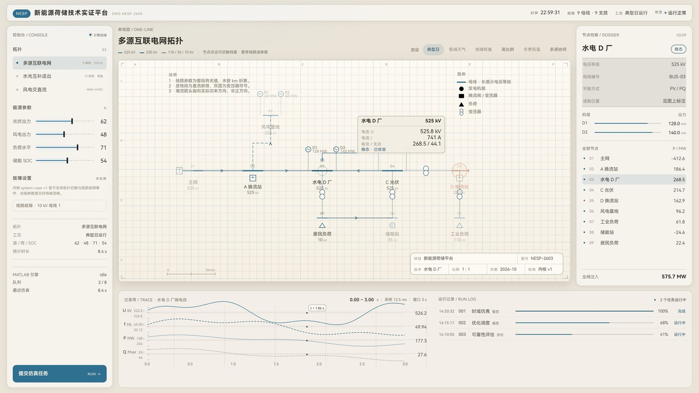

# 新能源荷储技术实证平台 · **v1 · 米白图纸大屏（单页面）**

> 一个单页工程图纸风格的大屏：中央是一张"电气单线图"纸面，左侧参数/记录、右侧节点档案、底部波形纸带与运行记录，右下角有工程图签。
> 设计基准 1920×1080，单屏无滚动。

 

## 预览



## 分支说明

本仓库用分支存放三个不同版本的前端：

| 分支 | 内容 |
| --- | --- |
| `main` | 科技风大屏（深蓝青，6 面板，ECharts） |
| **`v1-paper-sheet`（当前）** | **米白工程图纸大屏 · 单页面**（本分支） |
| `v2-workbench` | 米白工作台 · 多页面（侧栏 + 五视图） |

## 运行

```bash
cd frontend
npm install        # 或 pnpm install
npm run dev        # http://localhost:5180
npm run build      # 生产构建到 frontend/dist
```

## 主题

四套配色，通过 URL 参数切换，**默认米白**：

```
/?theme=paper      米白图纸（默认）
/?theme=blue       蓝黑
/?theme=graphite   石墨绿
/?theme=sepia      暖石灰
```

其他参数：`?sel=5` 选中指定母线（1–9），`?scenario=typical` 场景。

## 结构

```
frontend/
├─ src/
│  ├─ App.vue                单页装配：参数栏 / 图纸 / 档案 / 纸带
│  ├─ components/
│  │  ├─ SheetStage.vue      中央图纸（网格、图幅坐标、单线图、图例、说明、比例尺）
│  │  ├─ TitleBlock.vue      右下角图签
│  │  ├─ ConsoleRack.vue     左侧参数与读数
│  │  ├─ NodeDossier.vue     右侧节点档案
│  │  └─ RecordStrip.vue     底部波形纸带 + 运行记录
│  ├─ data/model.ts          示意数据（9 母线 / 9 支路 / 6 场景 / 任务）
│  └─ styles/app.css         设计 token 与四套主题
└─ server/mock-api.mjs       Node mock API（可选）
```

## 说明

- 所有数据均为**示意数据**，与任何真实电网拓扑无关；
- 真实拓扑与线路参数属于保密材料，不得写入本仓库。