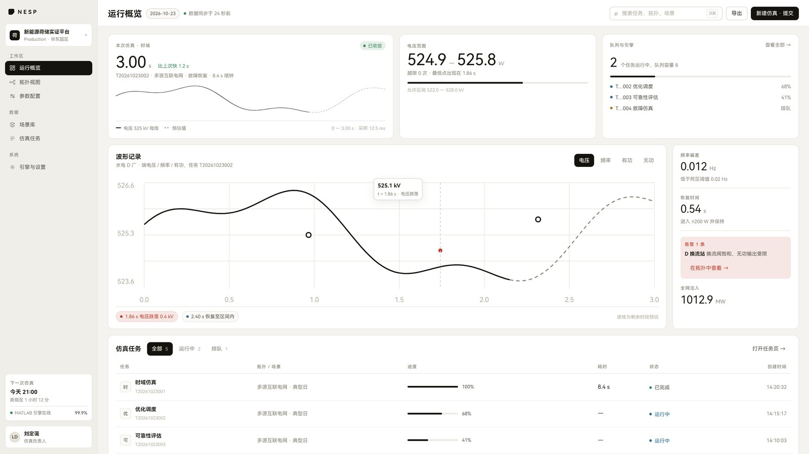
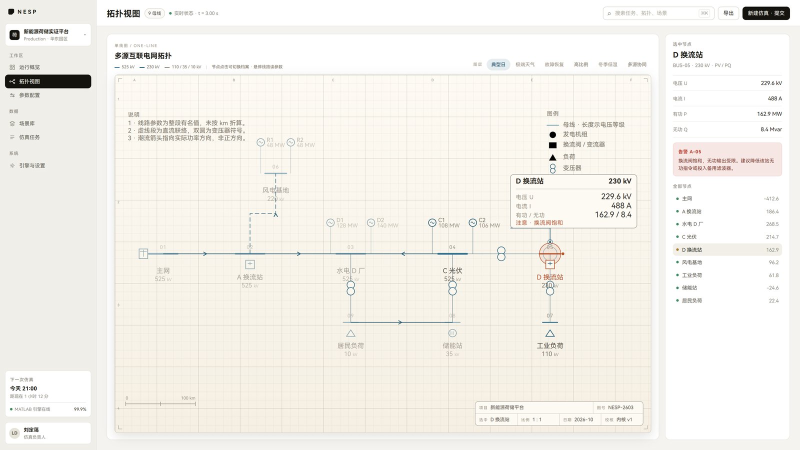

# 新能源荷储技术实证平台 · **v2 · 米白工作台（多页面）**

> B 端控制台形态：左侧分组导航 + 顶部工具条 + 卡片/表格内容区，五个视图（运行概览 / 拓扑视图 / 参数配置 / 场景库 / 仿真任务）。
> 拓扑视图采用 v1 的米白工程图纸语言（网格、图幅坐标 A–F·1–4、图例、说明、比例尺、图签、引出标注）。

## 预览



### 拓扑视图（米白工程图纸）


## 分支说明

本仓库用分支存放三个不同版本的前端：

| 分支 | 内容 |
| --- | --- |
| `main` | 科技风大屏（深蓝青，6 面板，ECharts） |
| `v1-paper-sheet` | 米白工程图纸大屏 · 单页面 |
| **`v2-workbench`（当前）** | **米白工作台 · 多页面**（本分支） |

## 运行

```bash
cd frontend
npm install        # 或 pnpm install
npm run dev        # http://localhost:5180
npm run build      # 生产构建到 frontend/dist
```

视图直达：

| 视图 | 地址 |
| --- | --- |
| 运行概览 | `/?tab=overview` |
| 拓扑视图 | `/?tab=topology` |
| 参数配置 | `/?tab=config` |
| 场景库 | `/?tab=scenarios` |
| 仿真任务 | `/?tab=tasks` |

## 结构

```
frontend/
├─ src/
│  ├─ App.vue                外壳：侧栏 + 顶栏 + 视图切换
│  ├─ components/
│  │  ├─ SideNav.vue         232px 分组导航
│  │  └─ TopBar.vue          标题 / 日期 / 搜索 / 导出 / 新建仿真
│  ├─ views/
│  │  ├─ OverviewView.vue    概览卡 + 波形 + 指标列 + 任务表
│  │  ├─ TopologyView.vue    米白图纸单线图 + 右侧节点检查器
│  │  ├─ ConfigView.vue      拓扑选择 / 能源参数 / 工况 / 故障灰置
│  │  ├─ ScenariosView.vue   场景表
│  │  └─ TasksView.vue       任务表
│  ├─ data/model.ts          示意数据
│  └─ styles/app.css         设计 token（暖灰底 / 白卡 / 黑色主色 / 语义色）
└─ server/mock-api.mjs       Node mock API（可选）
```

## 设计约定

- 颜色只引用 `src/styles/app.css` 的 CSS 变量；红仅告警、琥珀仅排队、绿仅完成；
- 图纸配色在拓扑页内用作用域变量覆盖，不改全局 token；
- 故障设置因仿真内核无对应字段，整组灰置并写明原因，不做假按钮；
- 单页无路由；视图由 `?tab=` 决定。

## 说明

- 所有数据均为**示意数据**，与任何真实电网拓扑无关；
- 真实拓扑与线路参数属于保密材料，不得写入本仓库。