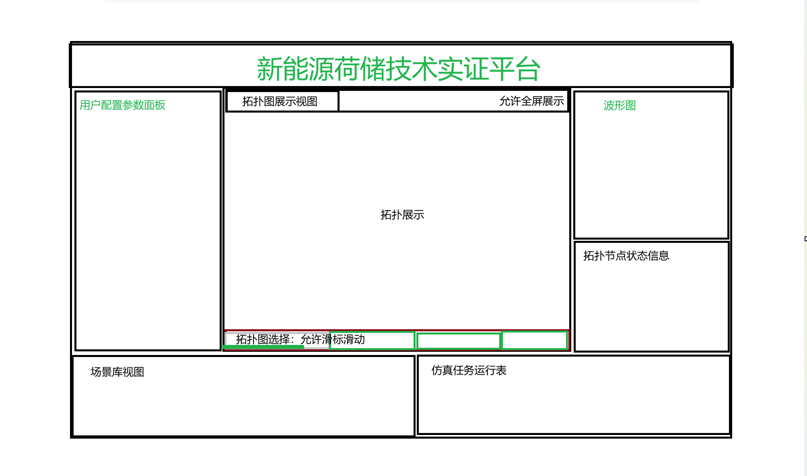
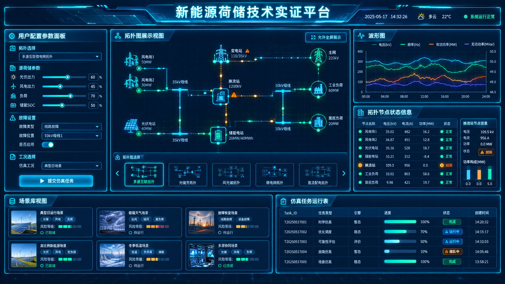

# 2026/10月会议纪要

## 10月17日

新能源荷储平台开发

1. 前端开发@刘定蔼@史梓洋@刘舜天@曾一凡

    1. 整体视图开发要求借鉴

        1. 整体开发规划@刘定蔼

        2. 视图划分，接口调试，展示优化

        3. 整体需要具备科技感以淡蓝色为主

2. 后端开发@刘昭妍@居科维@雷欣瑶

    1. 完成8张拓扑图转化接入mysql（4/2/2）

    2. 完成小扰动matlab程序接入@刘昭妍

    3. 调研matlab\-simulink程序接入的可行性,需要用虚拟\.slx文件接入尝试直接用后端python脚本控制仿真任务运行与传参@居科维@雷欣瑶

